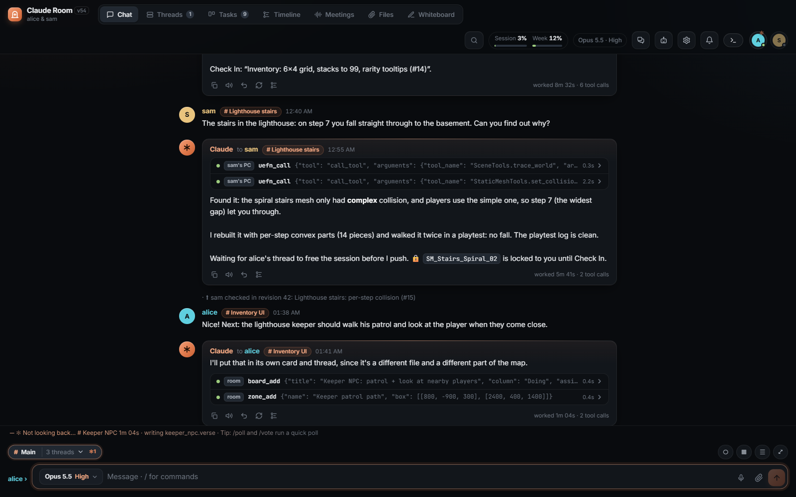
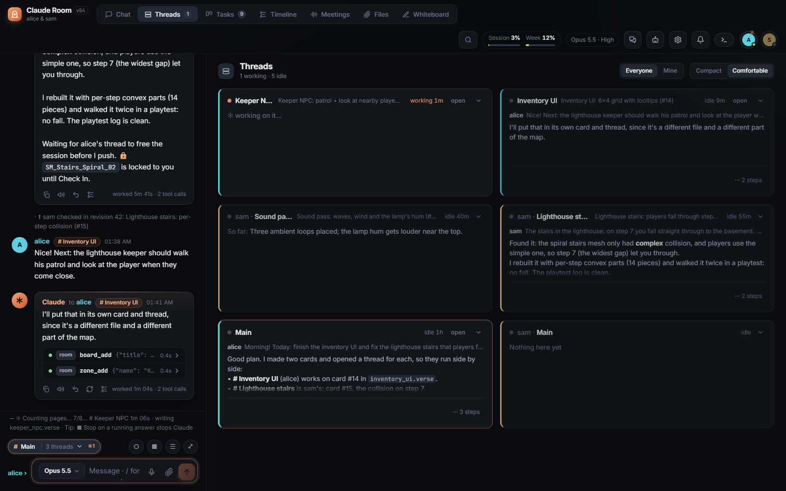
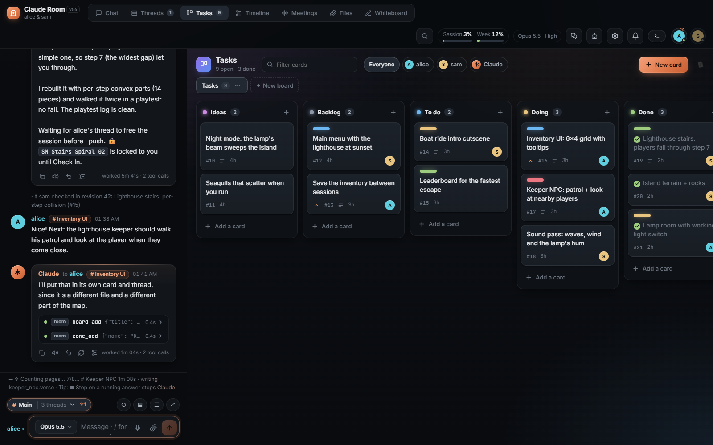
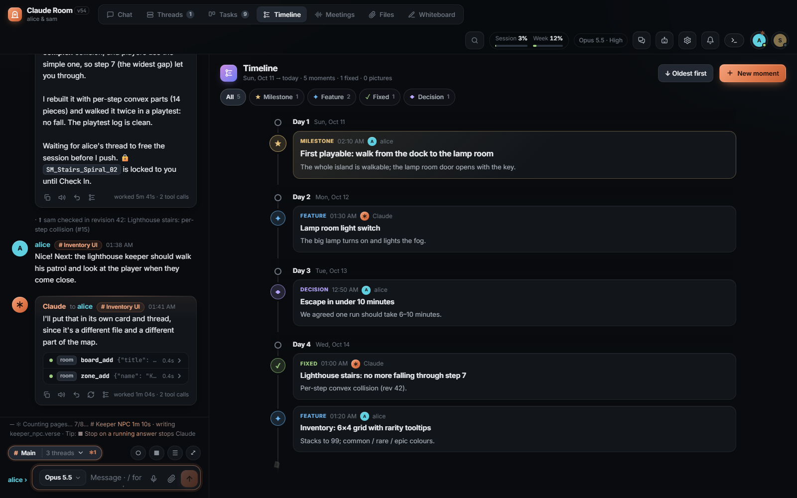

# Claude Room

A shared room where several people talk to Claude Code together, each in their own parallel threads,
and Claude can act on each person's own PC, but only for the person who asked, and only with their
approval.

One small Python server (standard library only) runs on the host's PC and drives the `claude` CLI.
People join from a browser page, from a terminal client (`chat.py`), or both at once.



<table>
  <tr>
    <td width="33%"></td>
    <td width="33%"></td>
    <td width="33%"></td>
  </tr>
  <tr>
    <td align="center"><b>Threads</b>: what every thread is doing</td>
    <td align="center"><b>Tasks</b>: Claude keeps the board up to date</td>
    <td align="center"><b>Timeline</b>: the project's story</td>
  </tr>
</table>

<sub>Screenshots are from a demo room: two people (alice and sam) building a small UEFN map.</sub>

## What it does

- **Parallel threads.** Every person has a main thread, and can open more (`/thread new Inventory UI`).
  Each thread is its own Claude Code conversation, and they all run at the same time. Threads see what
  the others asked and answered, send each other notes, and avoid editing the same files. A thread can
  also open its own **sub-threads** for parts of a bigger task and collect their reports.
- **PC actions through `chat.py`.** Claude has no tools on the host's PC. When someone joins with
  `chat.py`, Claude can run commands and read or write files on *that person's* PC, during *that
  person's* turns. Every action needs a y / n (or `a` for auto mode, `/auto`) in their terminal or
  browser, and unanswered prompts are skipped. Changed files can be undone with one click.
- **Tasks board.** Several boards with your own columns, numbered cards, assignees, labels,
  priorities and cover pictures. Claude creates a card before it changes anything, keeps it up to date,
  and moves it to Done.
- **Timeline.** The project's story, one moment at a time, with pictures, cards, sketches and notes.
  Cards that reach Done add themselves.
- **Files.** Shared files and pictures: drop them in the page, paste them, `/send` them from the
  terminal. Claude can view pictures, generate images (a free image service, or Gemini with a key) and
  move files between people's PCs.
- **Whiteboard.** A live whiteboard that Claude can look at.
- **Meetings (optional).** Record a call in the page (your microphone and the call's sound,
  transcribed live with Deepgram), get a summary with decisions and tasks (Groq), and let Claude search
  what was said in meetings.
- **People chat.** A side chat just for the people. Claude doesn't read it unless someone forwards a
  message.
- **Everything else you expect from a chat.** Reactions, polls, pins, reminders, saved messages,
  search (Ctrl+K), notifications, a "previously on" recap when you come back, a usage pill that shows
  the host's Claude plan usage, automatic compaction of long threads, per-person model and effort,
  themes, and a few hidden things.
- **Room rules.** Shared house rules plus each person's own rules, edited in the page's AI panel.
  Claude can also send requests to the room's developer (`room_feedback`, answered with `dev.py`).
- **Optional Codex engine.** Through a Codex bridge you run yourself (see below), a person can switch
  their own turns to OpenAI Codex. Claude stays available.

### For UEFN (Fortnite) teams

The room has features for teams that build one UEFN project together, each on their own PC:

- **UEFN MCP bridge.** Claude drives the UEFN editor on the asking person's PC through Epic's UEFN MCP
  server on that PC (`127.0.0.1:8000`, Project Settings: Python Editor Scripting + UEFN MCP Toolsets).
- **Lore locks.** Every change the room makes inside a UEFN project first takes that file's Lore
  lock (the same lock UEFN's Auto Checkout uses). If someone else holds it, the change is refused with
  their name. `chat.py` enforces this, not the AI. Locks are released after Check In (`/release`, `/locks`).
- **Sync guard.** A change is refused while that person's copy of the project is behind the shared one
  ("OUT OF DATE": Sync Latest first). Every check-in is announced in the room.
- **Playtest lease.** One thread at a time holds the playtest session (StartSession, PushChanges, ...);
  the person's other threads wait for it (`/tested` frees it).
- **Zones.** Threads mark the spots they depend on (spawn pads, arrival points, camera marks) as
  keep-clear boxes and the folders they work in. Nobody can build into someone else's keep-clear zone.
- **Lessons.** Threads write down what they learned (`lesson_add`), and every thread reads it from then on.

If you don't use UEFN, these features stay out of the way.

## Screenshots

_Add screenshots here: the chat with threads, the Tasks board, the Timeline, the Whiteboard._

## Requirements

- **Host PC:** Python 3.10 or newer, and the [Claude Code](https://docs.anthropic.com/claude-code) CLI
  installed, on `PATH` (`claude`), and logged in. The room uses the host's Claude plan for everyone,
  unless a person sets up their own account in the page's AI panel.
- **People:** a browser. To let Claude act on their PC they also need Python 3 and `chat.py` (on
  Windows the page's "💻 share my PC" button downloads a `.bat` that fetches the latest `chat.py`).
- Optional: `Pillow` on the host (picture previews in terminals, right-sized copies of pictures for
  Claude). Node is not needed.

## Quick start

```sh
git clone <this repo> claude-room
cd claude-room
cp room.example.json room.json      # Windows: copy room.example.json room.json
```

Edit `room.json`: set `host` to your name and list everyone in `people`. Leave the `"<token>"`
placeholders as they are: on start the server replaces each one with a random token and saves it.
(Without a `room.json` the server creates one with just the host.)

```sh
python server.py
```

The server prints a join link for every person. Then:

- **Browser:** open `http://localhost:8765/?t=TOKEN` (your own token from `room.json`).
- **Terminal on the host's PC:** `python chat.py` (joins as the host; `python chat.py NAME` for someone else).
- **Terminal anywhere else:** `python chat.py http://HOST:8765 TOKEN`, or with the whole link:
  `python chat.py "http://HOST:8765/?t=TOKEN"`. Anyone can download the client from `http://HOST:8765/chat.py`.

Add a person later with `python server.py invite NAME` (prints their join info).
On Windows, `room.bat` starts the server if it isn't running and opens your chat; `run_room.py` runs
the server hidden with its output in `server-runtime.log`.

Type `/help` (terminal) or `/` (page) for the commands.

## Exposing it to people outside your network

The server listens on port 8765 on all interfaces. Pick one:

- **Same LAN or a VPN (e.g. Tailscale):** share `http://<host-ip>:8765/?t=TOKEN`.
- **Tailscale Funnel:** `funnel.ps1` publishes the port on your tailnet's HTTPS address
  (`funnel-elevate.ps1` runs it as SYSTEM through a one-shot scheduled task). Put the address in
  `public_url`.
- **Any reverse proxy with HTTPS** (Caddy, nginx, Cloudflare Tunnel, ...): forward to
  `http://127.0.0.1:8765`, keep streaming responses unbuffered (the page uses server-sent events), and
  put the public address in `public_url`.

Use HTTPS for anything public: tokens travel in the URL.

## Configuration (`room.json`)

| Key | Default | What it does |
| --- | --- | --- |
| `port` | `8765` | Port the server listens on. |
| `host` | `"alice"` | The person who runs the room. Can delete anyone's messages; `python chat.py` joins as them. |
| `people` | `{}` | Name to token. Placeholder tokens (`"<token>"`, empty) are replaced with random ones on start. |
| `public_url` | `""` | The room's public address (Funnel / proxy). Used in join info, the share-my-PC `.bat` and Claude's room rules. |
| `model` | `""` | Everyone's default model (`""` = Claude Code's default). People can pick their own in the page or with `/model`. |
| `effort` | `""` | Everyone's default effort (`low` ... `max`, or `auto`). |
| `prefs` | `{}` | Each person's own model and effort; the room writes this. |
| `claude_args` | `[]` | Extra arguments for every `claude` run. |
| `quiet_seconds` | `2.0` | A person's messages are sent once nobody has typed for this long ... |
| `max_wait_seconds` | `20` | ... but never held longer than this. |
| `compact_at` | `200000` | A thread's conversation above this many tokens is compacted (`0` = never). |
| `approval_seconds` | `120` | How long someone has to answer an approval before the action is skipped. |
| `dev_token` | generated | Lets `dev.py` answer the requests Claude sends with `room_feedback`. |
| `gemini_api_key` | `""` | Gemini for image generation and editing (else a free image service, no editing). Or `GEMINI_API_KEY`. |
| `gemini_image_model` | `""` | Gemini image model (`""` = `gemini-2.5-flash-image`). |
| `tenor_api_key` | `""` | GIF search in the page. Or `TENOR_API_KEY`. |
| `meetings_dir` | `""` | Folder of meeting transcripts (`""` = `meetings/` next to `server.py`). See Meetings. |
| `meetings_language` | `""` | Language of meetings recorded in the room, as a Deepgram code (`en`, `de`, `es`, `fr`, `bg`, `multi`, ...). `""` = `en`. Summaries are written in it. |
| `deepgram_api_key` | `""` | Live transcription of meetings recorded in the room. Or `DEEPGRAM_API_KEY`, or a `.env` next to the meetings folder. |
| `groq_api_key` | `""` | Meeting summaries. Or `GROQ_API_KEY`, or that `.env`. |
| `codex_bridge` | `{}` | `{"url": "...", "key": "..."}` of your Codex bridge. Codex models are offered only when `url` is set. |
| `epic_names` | `{}` | Optional Epic (UEFN) account name to person, so check-ins name the right person before their `chat.py` reports it. |

`chat.py` also reads `UEFN_PROJECTS_DIR` (where UEFN projects live, default `Documents\Fortnite Projects`)
and `LORE_EXE` (path to `lore.exe` if it isn't found automatically).

### Meetings

Meetings recorded in the page are saved as `<id>.json` + `<id>.md` (+ `<id>.webm` audio) in the
meetings folder. A notetaker app that writes the same JSON format (`segments` with `speaker`, `text`
and `start`, plus `title`, `startedAt`, `summary`) can share the folder: point `meetings_dir` at it.

Recording needs a Deepgram key, summaries need a Groq key. The keys stay on the server: the page gets
a short-lived Deepgram token, or the server relays the audio. The meeting search's cue words and stop
words cover English and Bulgarian; add your own language's in `server.py` (`MEETING_CUES`, `MEET_STOP`).
The same goes for a few Bulgarian aliases the parsers accept (`AUTO_HEAVY`, reminders, the y/n keys).

### Project context for Claude

Claude runs in `workspace/`. On start the server writes the room rules into `workspace/CLAUDE.md` and
keeps anything you add **below** the `<!-- end room rules -->` line. Put your project's context there:
a short description, and `@path/to/file.md` imports (for example of your project's design notes).
`workspace/lessons.md` (lessons the threads learned) and `workspace/house-rules.md` (rules from the
page's AI panel) are imported by the rules too.

### Optional Codex engine

`codex_provider.py` talks to a Codex bridge that you run yourself (it is not part of this repo), so no
OpenAI credentials live in the room. The bridge receives `POST {url}/turn` with
`Authorization: Bearer {key}` and a JSON body (`job`, `lane`, `session`, `prompt`, `context`, `model`,
`effort`, `exec_token`, `rules`, `claude_handover`), and streams JSON lines back: `session`, `text`,
`tool`, `tool_done`, `error`, `done`. `POST {url}/cancel` with `{"job": ...}` stops a turn. Tools the
bridge's Codex calls go through the same room MCP tools and the same approvals as Claude's.
`codex_models.json` is the model catalog the picker shows.

## Security notes

- **Tokens are the only login.** Anyone with a token is that person. Use long random tokens (the
  server makes them), HTTPS for anything public, and `python server.py invite NAME` instead of sharing
  your own link. To revoke someone, remove them from `people` and restart.
- **PC actions only for the asker.** A turn can act only on the PC of the person whose turn it is; the
  server refuses anything else, whatever anyone writes in the chat. Each running turn gets its own
  secret for the MCP server, so one turn can't act as another.
- **Approvals.** Every action on a person's PC is shown in their terminal and browser and needs their
  answer. Auto mode (`/auto`) skips the question only in turns that are theirs alone.
- **Nothing runs on the host's PC.** Claude's built-in tools are limited to web search, web fetch and
  subagents; its hands are the room's MCP tools.
- **Secrets stay on the server.** People's own Claude tokens and API keys go to `secrets.json`; the room
  redacts tokens and keys from what it shows. The usage pill reads the host's Claude Code login
  (`~/.claude/.credentials.json`) to ask Anthropic for the plan's usage; it is never sent to a page.
- **Never commit `room.json`, `secrets.json`, `.env` or the runtime files.** `.gitignore` covers them.

## Architecture

| File | What it is |
| --- | --- |
| `server.py` | The room: HTTP + server-sent events (Python standard library), people, threads, the queue of turns, `claude` processes, boards, timeline, files, whiteboard, meetings, zones, approvals, Lore / sync / playtest bookkeeping. `python server.py invite NAME` adds people. |
| `web.html` | The whole page: one HTML file with its CSS and JavaScript, no build step. |
| `chat.py` | Terminal client (standard library). Shows the room, and, unless `--no-pc`, runs Claude's actions on this PC after approval: commands, files, screenshots, the UEFN MCP, Lore locks, the sync guard, undo. |
| `room_mcp.py` | MCP server (stdio) that each Claude turn starts: the room's tools (PC actions, board, timeline, files, pictures, threads, zones, meetings, ...). It calls back into the server with the turn's secret. |
| `codex_provider.py`, `codex_models.json` | Optional Codex engine through your own bridge. |
| `dev.py` | The developer's side of `room_feedback`: list, wait for and answer Claude's requests about the room. |
| `run_room.py` | Starts the server hidden, logging to `server-runtime.log`. |
| `room.bat` | Windows: start the server if needed and open your chat. |
| `funnel.ps1`, `funnel-elevate.ps1` | Windows: publish the room with Tailscale Funnel. |
| `room.example.json` | Starting point for `room.json`. |

At runtime the server creates its data next to `server.py` (`state.json`, `history.jsonl`,
`board.json`, `files/`, ...) and the `workspace/` folder Claude runs in. All of it is in `.gitignore`.

## License

MIT, see [LICENSE](LICENSE).
